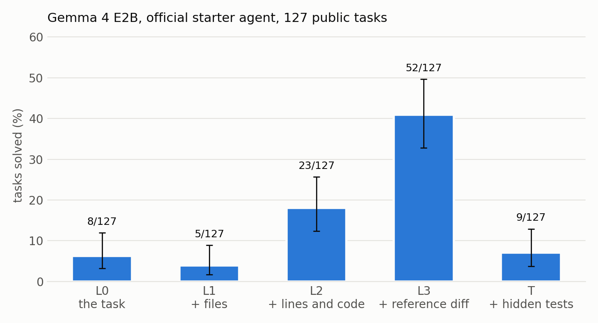
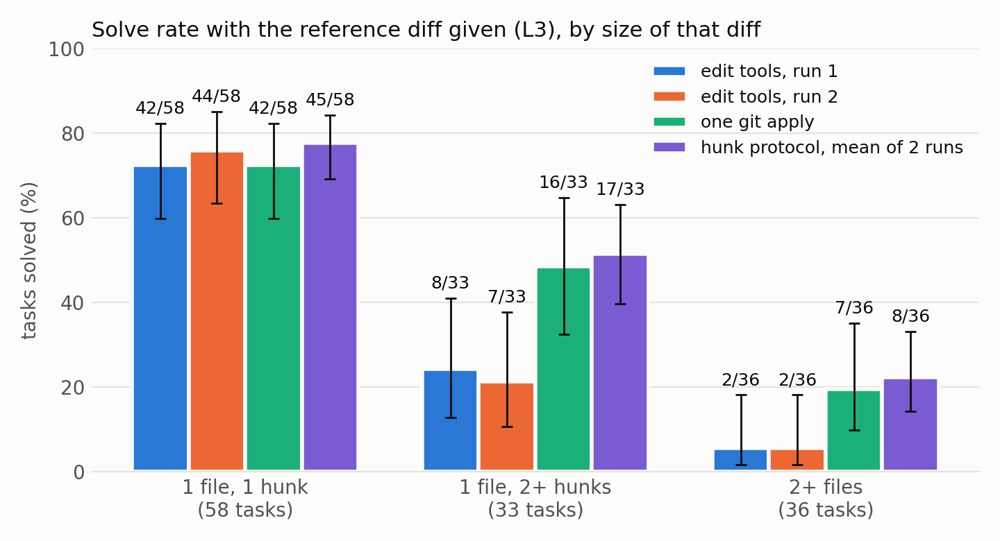

# Handed the Fix, Still Failing

**An oracle ladder for a small software agent, and a repair of its largest loss that does not carry over**

## Abstract

Gemma 4 E2B solves 6.3% of the competition's public tasks in the official harness [C-001]. Agent designs cannot be told apart at that level, so we ask where tasks are lost, then test whether repairing the largest loss helps. An oracle ladder runs the same agent while the hint channel carries reference information: the files to change, the lines, the full reference diff, or the hidden tests. Files and tests change nothing. Showing the lines lifts the solve rate to 18.1%, and handing over the complete fix only to 40.9% [C-003, C-004]: the agent fails 59.1% of tasks whose answer it holds [C-022]. From the failure labels we built an edit protocol (a tolerant `git apply`, hunk by hunk) and tested it under a rule fixed before the data. With the fix in hand it solves 65 and 75 tasks where the starter agent solves 52 and 53 (exact sign-flip p = 0.001) [C-064], and 97 against 83 on E4B [C-090]. The gain does not carry over. When the agent must write the fix, the protocol solves 13 tasks against 23 with the lines shown, and 4 against 8 in the competition condition [C-070, C-071]. The largest residual on the ladder was not the bottleneck. Nothing here raises the competition score; we report what perfect retrieval, perfect planning and better edit tooling can each buy this agent at most, and the noise a claimed gain must clear: identical runs disagree on 21 of 127 tasks [C-045]. We release the harness, over 2,400 graded episodes with traces and labels, and a ledger tying every number to a file.

## 1. Introduction

Our first leaderboard entry, the official starter agent on E2B, scored 0.03 on the hidden set [C-050]. On the public tasks it solves 8 of 127, and three prompt variants solve 6, 7 and 8 [C-001, C-006, C-008, C-009]: differences that carry no information.

What can be measured with large effects is where the loss occurs. Fixing an issue takes three things: finding the code, writing the change, and getting the change into the files through the tool interface. We remove them one at a time with oracle information, inside the unmodified harness. A diagnosis is useful only if acting on it helps, so we build the intervention it asks for and test it at the diagnosed stage and below. The method needs only tasks with reference patches and a way to add text to the task, so it applies to other models and benchmarks.

Contributions:

1. **The oracle ladder**, a diagnostic that needs no change to the agent or the scorer, and its decomposition for Gemma 4 E2B.
2. **An intervention that passes a pre-registered test** at the diagnosed stage, with a rerun and a second model, **and gains nothing below it**: the largest oracle residual need not be the bottleneck.
3. **A measured noise floor** and a **resource**: harness, traces, labels and an evidence ledger.

## 2. Method

**The ladder.** Each task is run at five levels; only the text under the task's "Hints" heading changes.

| Level | Added to the task | Stage it removes |
|---|---|---|
| L0 | nothing | none: the competition condition |
| L1 | paths of the files the reference patch changes | file localization |
| L2 | L1 plus each changed line range with its current code | all localization |
| L3 | the reference diff, with the instruction to apply exactly it | synthesis; transcription remains |
| T | the hidden tests | ambiguity about what "fixed" means |

Solve(L2) − Solve(L0) is the localization gap, Solve(L3) − Solve(L2) the synthesis gap, and 1 − Solve(L3) the residual lost when nothing is left to find or invent. Levels above L0 are upper bounds: a perfect retriever cannot do better than L2, and a perfect planner cannot do better than L3, unless later stages also change.

**Setup.** Official `swegemma` 0.2.11 harness on four L4 GPUs under the scorer's flags, model `gemma-4-e2b-it-qat-w4a16-ct`, temperature 0.2, at most 8,192 output tokens per turn, and per episode 24 tool calls, 5 minutes and 60 turns. Grading uses the scorer-like sandbox of Kirchner [6]; we keep the 127 of 129 public tasks whose reference patch passes there. Hints are clipped at 16,000 characters, which affects 8 tasks at L3.

**Agents.** `base` is the official starter bundle (nine tools, edits by exact string replacement). `lean` (short prompt, no `write_file`), `nothink` (thinking off) and `pax` (an incomplete Personaxis persona) are prompt variants. `pax2` applies that format in full: ten layers compiled into the prompt, a procedure skill with checks, and sourced knowledge. `patch` is `base` without `edit_file` and `write_file`: the agent sends one unified diff to `git apply` inside `run_command`. `hunk` is `patch` with one command per file and `git apply --recount --reject --unidiff-zero --ignore-whitespace`: header counts are ignored, each hunk applies or is rejected alone, and whitespace errors in context are tolerated. All are plain bundles the scorer accepts.

**Runs.** Wave 1: `base` at five levels and the variants at L0, L2 or L3. Wave 2: `patch` at L3 and reruns of `base` at L3 and L0. Wave 3: `hunk` at L3 twice, at L2 and at L0, then `base` and `hunk` at L3 on E4B. In total 19 arms and 2,413 graded episodes [C-097]; each wave was designed after reading the one before.

**Statistics.** Wilson 95% intervals; comparisons are paired by task (exact McNemar), and "a vs b" counts the tasks only one arm solves.

**Reading rules, each fixed before its data.** (i) The persona is rejected if, over L0 and L2, it loses at least five more tasks than it wins. (ii) With d the number of tasks on which two identical `base` runs at L3 disagree, `patch` "removes part of the residual" only if its net gain exceeds d and p < 0.01. (iii) For `hunk`, D sums over tasks the solves in two `hunk` runs minus those in two `base` runs at L3; it removes part of the residual only if D > 0 and an exact sign-flip test gives p < 0.01. Under the null the four runs of a task are exchangeable, so the test contains run-to-run noise; rule (ii) compared a net count with a gross one and was too strict. (iv) Carry-over at L2 or L0 is claimed only if p < 0.01 in every pairing at that level, with one sign. We predicted none.

**Failure labels.** A script labels every unsolved episode by its patch at grading: empty, destructive overwrite (a `write_file` that deletes at least 20 lines more than the reference), incomplete (L3 only: reference lines missing), or wrong. A hand-check of 20 episodes agreed on all 20.

## 3. Results

### 3.1 The largest loss comes after the answer is known

| Level | Solved | 95% interval | Paired against |
|---|---|---|---|
| L0 | 8/127 = 6.3% | 3.2–11.9 | |
| L1 | 5/127 = 3.9% | 1.7–8.9 | L0: 4 vs 7, p = 0.55 |
| L2 | 23/127 = 18.1% | 12.4–25.7 | L0: 16 vs 1, p = 0.0003 |
| L3 | 52/127 = 40.9% | 32.8–49.6 | L2: 36 vs 7, p < 0.0001 |
| T | 9/127 = 7.1% | 3.8–12.9 | L0: 6 vs 5, p = 1.0 |

Sources: [C-001]–[C-005], [C-011], [C-012], [C-014], [C-030].

File names and hidden tests do not help. Showing the lines and their current code does: the localization gap is 11.8 points [C-020]. Writing the fix is worth more, 22.8 points [C-021]. The residual is larger than both together: 59.1 points [C-022], or 56.3 on the 119 tasks whose hint was not clipped [C-026]. It grows with the text to transfer (Figure 2): with the diff in hand the agent solves 72.4% of one-hunk tasks, 24.2% of those with several hunks in one file, and 5.6% of multi-file ones [C-028].

### 3.2 What the agent does with the answer

Patch state at grading at L3, on the 119 complete-hint tasks:

| Patch at grading | `base` run 1 | `base` run 2 | `patch` | `hunk` run 1 | `hunk` run 2 |
|---|---|---|---|---|---|
| Solved | 52 | 53 | 65 | 65 | 75 |
| Empty | 9 | 18 | 35 | 26 | 18 |
| Destructive overwrite | 25 | 18 | 0 | 0 | 0 |
| Incomplete | 23 | 24 | 18 | 24 | 25 |
| Complete but failing | 10 | 6 | 1 | 4 | 1 |

Sources: [C-033], [C-053], [C-052], [C-098].

The budget is rarely the cause at L3: of 75 unsolved `base` episodes, 58 ended with `submit_patch` and 17 timed out [C-040]. In 29 the last edit before submitting had failed [C-058]. `edit_file` replaces an exact string. Of 386 calls at L3, 146 succeeded and 156 were rejected because the string was not in the file [C-037]; 134 of those strings were not a verbatim copy of the lines the hint shows [C-039]. The model retypes the text and gets it wrong, then falls back to `write_file`: of 66 successful writes, 48 replaced an existing file [C-058].

The lower levels fail differently. At L2, 90 of 104 unsolved episodes end with a patch that is in place and wrong [C-036]: the edits land, and the content is the problem. At L0, 58 of 119 unsolved episodes submit a wrong patch, 17 an overwrite, and 44 nothing [C-035].

### 3.3 Prompt variants and the noise floor

At L0, `lean`, `nothink` and `pax` are indistinguishable from `base` (3 vs 4, 4 vs 4, 2 vs 4) [C-015, C-017, C-018]. The first persona meets rejection rule (i) with a net of −6 [C-031]. The full one does not help either (rule fixed first: p < 0.01): on E4B at L0 it solves 15/127 against 18/127 (6 vs 9, p = 0.61) [C-105, C-100, C-106], and 15 against 19 on one A100 (4 vs 8, p = 0.39) [C-109, C-108, C-110]. It loaded its procedure skill in 103 of 127 episodes, its knowledge in one [C-107].

Two identical `base` runs at L3 solve 52 and 53 tasks and disagree on 21 [C-004, C-042, C-045]. At L0 both solve 8 and disagree on 6 [C-043, C-046]. The two `hunk` runs disagree on 28 [C-087]. One task in five or six flips between identical runs, so a paired difference from single runs means little.

### 3.4 Changing the edit primitive

If exact-string replacement is the obstacle, a diff should help. `patch` at L3 solves 65/127 = 51.2% (42.6–59.7) [C-041]; against the first `base` run it wins 23 tasks and loses 10 (p = 0.035) [C-044]. The net of 13 does not exceed d = 21 and p is not below 0.01: **under rule (ii) the patch channel is not shown to help** [C-059]. The failures changed form. Of 250 `git apply` calls, 73 were rejected as corrupt (hunk header and body disagree) and 48 because context lines did not match [C-054]; token-limit cut-offs inside a tool call rose from 7 and 9 to 44 [C-056]. One bad hunk voids the whole diff.

### 3.5 A protocol built from those counts

`hunk` answers each count with a `git apply` flag. It solves 65/127 and 75/127 at L3 [C-060, C-061].

Run by run, the first `hunk` run wins 28 tasks and loses 15 and 16 against the two `base` runs (p = 0.066 and 0.096); the second wins 32 and 28 and loses 9 and 6 (p = 0.0004 and 0.0002) [C-065]–[C-068]. Pooled over the four runs, D = 35 with 59 non-zero tasks, p = 0.0011. **Rule (iii) is met: the protocol removes part of the transfer residual** [C-064]. The gain sits where the residual was worst: tasks with several hunks in one file go from 24.2% to 48.5% and 54.5%, multi-file tasks from 5.6% to 22.2% in both runs [C-028, C-072, C-073]. Corrupt-patch rejections fall from 73 to 11 and 6, and 96 and 105 episodes get at least one hunk applied [C-075, C-078]. Cut-offs do not fall (35 and 46) [C-076, C-079], and the agent still fails 62 and 52 tasks with the fix in its prompt.

One caution: the first `hunk` run equals `patch` (65), so we cannot say the flags add to plain `git apply`. The three diff-channel runs together show that a diff transfers a given fix better than string replacement [C-099].

### 3.6 The gain does not carry over

At L2 and L0 the agent must write the change itself. With the lines shown, `hunk` solves 13/127 = 10.2% against 23 for `base`; it wins 2 tasks and loses 12 (p = 0.013) [C-062, C-070]. In the competition condition it solves 4/127 against 8 and 8, with 1 vs 5 and 2 vs 6 [C-063, C-071]. Under rule (iv) no effect is claimed at either level, as predicted. Every difference points against the protocol.

The traces say why. Copying a diff and composing one are different tasks. At L2, 137 of 244 `git apply` calls were rejected and 40 were corrupt [C-081], cut-offs inside a tool call reached 90 [C-082], and at least 71 of 114 unsolved episodes ended with no change in the repository [C-083]. Under `base` nearly every L2 episode lands an edit [C-036]. At L0, 161 of 218 calls were rejected, and 98 of 123 unsolved episodes ended empty, against 44 of 119 for `base` [C-084, C-086, C-035]. A string replacement asks for the few lines to change. A diff asks for exact context as well, and the model cannot supply it.

### 3.7 A second model

On E4B at L3, `base` solves 83/127 = 65.3% and `hunk` 97/127 = 76.4% (21 vs 7, p = 0.013; single runs, no rule) [C-088, C-089, C-090]. The shape repeats: one-hunk tasks do not move (93.1% and 91.4%), several hunks go from 63.6% to 84.9%, several files from 22.2% to 44.4% [C-091, C-092]. A larger model still fails a third of the tasks whose fix it holds. A fourth wave ran `base` on E4B at L0 and L2: it solves 18/127 = 14.2% and 34/127 = 26.8% [C-100, C-101] (single runs, 254 further episodes).

## 4. Discussion

**The largest residual was not the bottleneck.** After wave 1 we read the ladder as a ranking and concluded that the edit path came first. Wave 3 refutes that reading. Transcribing a long diff is a task that exists only at L3. Below it most of the agent's own edits land, and they are wrong. 1 − Solve(L3) measures a real weakness, verbatim transfer, in a stage the competition condition seldom reaches. A ladder says how much each stage could give if the later ones were perfect. Which stage binds is a separate question, and it takes an intervention with a carry-over test to answer it.

**For agent builders.** On these tasks perfect file retrieval gives E2B nothing, and perfect line-level retrieval at most 18% [C-003]. A perfect planner gives at most 41%, or 51–59% through a diff channel [C-004, C-060, C-061]. Edit tooling gives nothing at L0. What binds is the content of the change, which no prompt, persona, tool subset or edit format moved. The levers left are the model and its weights: a larger model, or fine-tuning aimed at writing the change once the lines are known, which L2 measures directly. The edit format should follow who writes the content: string replacement when the model composes, a tolerant per-hunk diff when it copies.

**For evaluation.** At these solve rates a paired difference needs a rerun. We suggest publishing the flip count of an unchanged arm beside any comparison and fixing the decision rule first. Without rule (iv) we would have reported the L3 gain as an improvement to the agent.

## 5. Limitations

Nothing here improves the score in the competition condition. Two models and one harness; the tasks come from four Python repositories, mostly fastapi and rich. The 5-minute episode limit is ours and the competition allows more; at L0, 40 of 119 unsolved `base` episodes end at it [C-096], so the L0 rates hold for this budget. Most arms have one run. The `hunk` controls are `base` runs of earlier waves. `hunk` changes four flags and the one-file rule at once; none is ablated. `patch`, `hunk` and the labels were designed on traces of the same tasks, so waves 2 and 3 are not held-out tests. E4B has single runs. The sandbox is scorer-like and is not the scorer. Two tasks are sometimes graded solved with an empty patch [C-057].

## 6. Related work

SWE-bench [1] introduced an "oracle" retrieval setting that gives the model the files the reference patch edits: our L1, worth nothing for this agent. Agentless [2] splits repair into localization and patch generation; we bound each stage from above inside one agent loop, remove synthesis as well, and test whether a bound predicts the effect of an intervention. SWE-agent [3] argued that the agent-computer interface decides performance; the carry-over test limits that claim for a small model. Aider [4] reported that the edit format changes results for large models, and Diff-XYZ [5] finds small open models limited at applying and generating diffs. Inside an agent loop we find the format that is better for applying worse for generating.

## 7. Reproducibility

Repository and notebook are under Project Links. `runs/` holds every configuration, result row and trace archive; `tools/` regenerates every table and figure. Each bracketed id is a record in `ledger/claim.jsonl` pointing to a file pinned by SHA-256; `tools/ledger.py validate` fails if a file changed or if this text cites an unverified claim. The reading rules and their dates are in the same ledger. The notebook reproduces the tables without a GPU.

## References

1. Jimenez et al. *SWE-bench: Can Language Models Resolve Real-World GitHub Issues?* arXiv:2310.06770.
2. Xia et al. *Agentless: Demystifying LLM-based Software Engineering Agents.* arXiv:2407.01489.
3. Yang et al. *SWE-agent: Agent-Computer Interfaces Enable Automated Software Engineering.* arXiv:2405.15793.
4. Gauthier. *Unified diffs make GPT-4 Turbo 3X less lazy.* aider.chat/docs/unified-diffs.html.
5. *Diff-XYZ: A Benchmark for Evaluating Diff Understanding.* JetBrains Research, arXiv:2510.12487.
6. Kirchner. *Gemma 4 Agent: Run Your Agent Locally.* Kaggle notebook, Apache-2.0.
